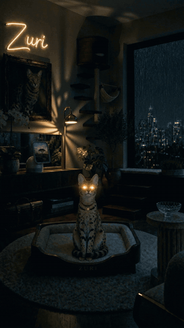
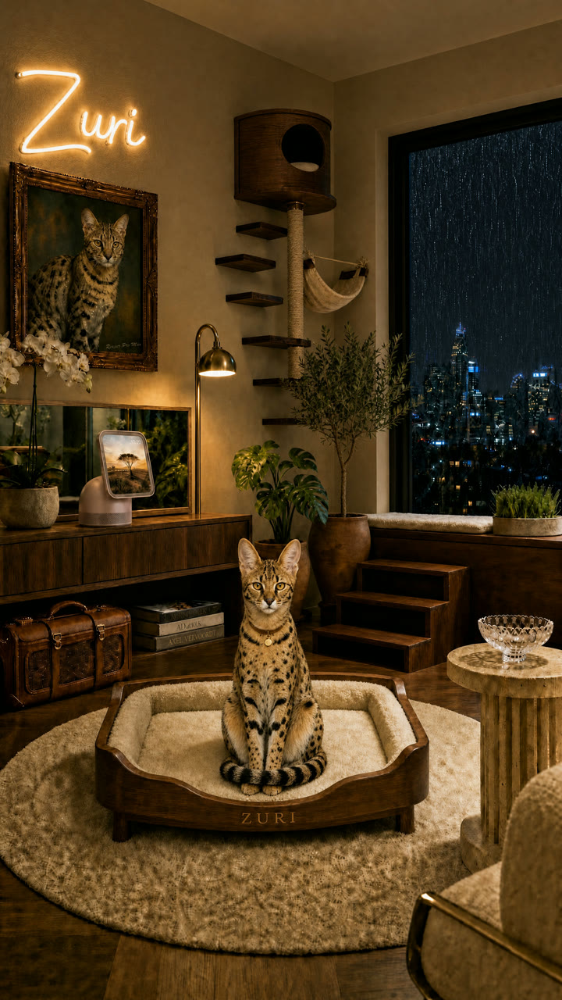
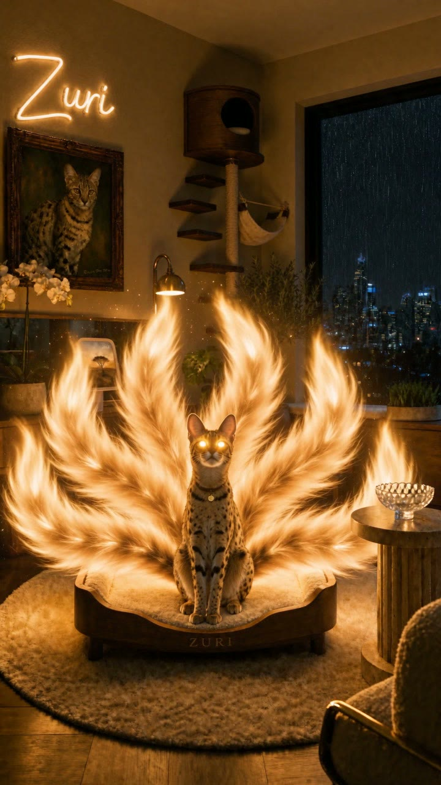
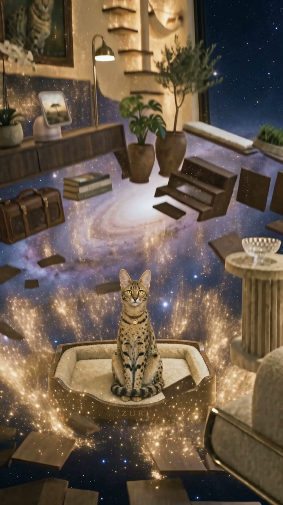
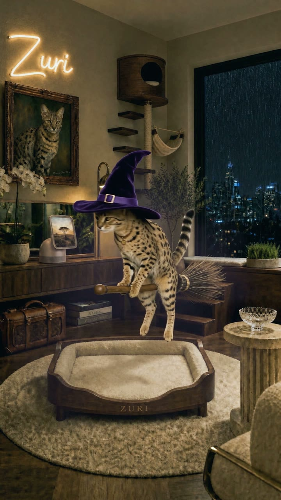
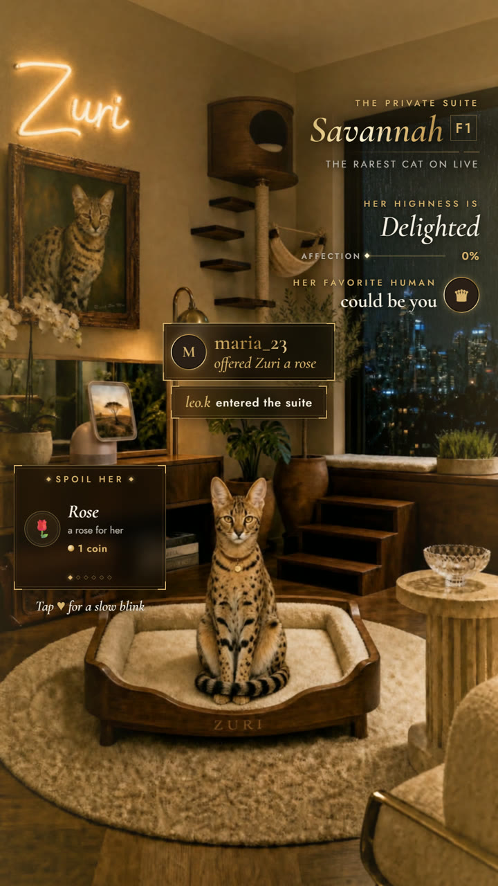
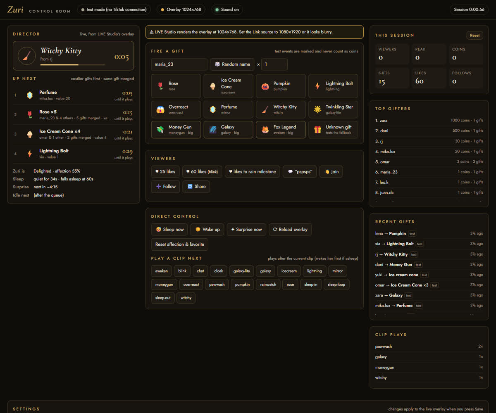
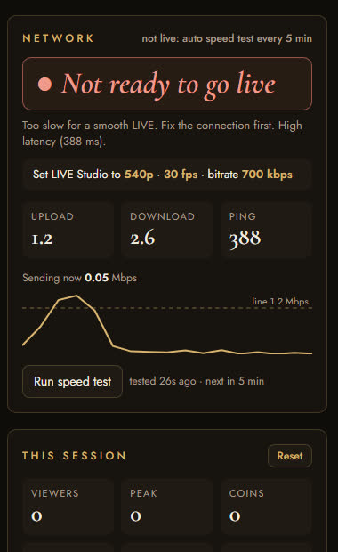
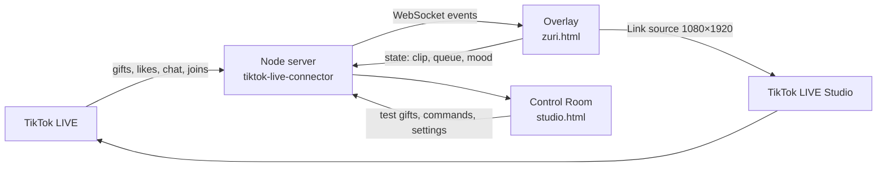

# TikTok LIVE Interactive

**Interactive TikTok LIVE apps where viewers' gifts, likes and chat drive what happens on stream in real time.**

One Node server bridges TikTok LIVE events (gifts, likes, chat, joins, follows) to browser overlays that TikTok LIVE Studio broadcasts. Each app is its own overlay on the same server and Control Room.

| App | What viewers do | Status |
|---|---|---|
| **[Zuri](#zuri-the-flagship)** | Gifts direct an AI-generated Savannah cat through film-quality reactions | Flagship, live |
| Latte (`public/latte.html`) | Gifts trigger a pet-influencer kitten's reactions; moods and a love meter | Earlier iteration |
| Lumo (`public/travel.html`) | Gifts send a mascot to impossible places, each with its own soundscape | Earlier iteration |
| Noct (`public/cat.html`) | A chaos cat with a gift queue and top-fan leaderboard | Earlier iteration |
| Dog dance (`public/overlay.html`) | Characters dance on gifts | First prototype |
| Interactive games | More gift-driven games | In progress |

> Not affiliated with TikTok. AI-generated characters carry TikTok's AI-generated content label on stream.

---

## Zuri, the flagship

Zuri is a rare Savannah F1 cat in a custom-built luxury suite on a rainy night. Every gift a viewer sends plays a film-quality reaction: she reveals nine golden spirit-tails, floats through a galaxy, turns into a witch and flies around the room, or gets a brain freeze from an ice cream cone. Between gifts she lives her own life: idle moments weighted by mood, a sleep mode when nobody interacts, and surprise moments of her own.

<p align="center">
  
</p>

<p align="center"><a href="docs/media/showreel.mp4"><b>▶ Watch the 30-second showreel</b></a></p>

| The suite | Nine tails (Fox Legend) | Galaxy | Witchy Kitty |
|---|---|---|---|
|  |  |  |  |

### What Zuri does

- **Gift reactions:** each TikTok gift maps to a clip (`config/zuri.json`). Rose, Ice Cream Cone, Pumpkin, Lightning Bolt, Overreact, Perfume, Witchy Kitty, Twinkling Star, Money Gun, Galaxy and Fox Legend each have their own scene. Gift names are matched loosely (spaces and capitals don't matter) and unknown gifts still get a reaction.
- **A seamless, never-frozen player:** every clip starts and ends on the same anchor frame, so two `<video>` elements hard-cut between clips with no visible seam. The next clip preloads while the current one plays, and a watchdog skips past stalls or broken files so the stream never stops.
- **A gift queue that behaves under chaos:** costlier gifts play first, cheap gifts gain priority while they wait, and the same pending gift is merged ("maria & 4 others ×5") instead of repeating. The queue is capped, and overflow gifts get an on-screen thank-you.
- **A cat with a life of her own:**
  - **Moods:** delighted, content, bored, drowsy, ignored. Each mood weights the idle moments differently.
  - **Sleep mode:** after a quiet minute she curls up and sleeps on a loop (enter → loop → exit). A gift or "pspsps" in chat wakes her at once.
  - **Surprises:** now and then she does a special moment on her own (her mirror, the window, tail spirits), labeled as her own whim. They're never presented as a viewer's gift.
  - **Variants:** some moments have several takes, picked at random each time.
- **Premium overlay:** gold-foil type, smoked-glass cards and a gift card that steps back while reactions play and glows when nobody's interacting. Every element has a fixed, non-overlapping place.

| Overlay | Control Room | Network check |
|---|---|---|
|  |  |  |

- **Control Room** (`/studio.html`), a director's dashboard for the stream:
  - what's playing with a countdown, and the gift queue with ETAs
  - fire test gifts, force any clip, sleep or wake her
  - session stats: viewers, coins, top gifters, plays per clip
  - live settings: idle weights shown as real percentages, sleep timer, surprise rates, gift mapping
  - warnings for a blurry LIVE Studio source, blocked sound or unknown gift names
- **Network go/no-go:** before going live it runs speed tests and recommends the exact LIVE Studio resolution, fps and bitrate. While live, it only watches real-adapter usage (no tests that would steal bandwidth) and warns when the stream fills the line.

### How it works



- **`server.mjs`** (Express + `ws`): bridges TikTok events to the overlay, keeps session stats, serves clips and settings, and reconnects to TikTok on its own after drops or when you go live again.
- **`public/zuri.html`:** the overlay LIVE Studio shows. It runs the player, the queue, the moods, sleep mode and surprises, and reports its state back once a second.
- **`public/studio.html`:** the Control Room.
- **`config/zuri.json`:** everything tunable (gifts, moods, weights, timers, surprises, queue limits, variants).

### The AI video pipeline

| Step | Tool | Notes |
|---|---|---|
| Character and room stills | Runway `gpt_image_2` (`tools/gen-image.mjs`) | One image at a time; reference images keep the cat identical across shots |
| Clips with native sound | Runway Seedance 2.5 (`tools/gen-video.mjs`) | Every clip uses the same anchor frame as **first and last keyframe**, so any clip can follow any other |
| Stream copies | ffmpeg (`season2/upscale.sh`) | Trims the keyframe "snap" frames, color-grades, Lanczos-upscales to 1080×1920, tags BT.601, swaps files in atomically |

**Lessons that shaped it:**
- Big rotations don't fit short keyframe-to-keyframe clips: the model "teleports" instead of turning.
- Rain must be described as clearly moving, or it freezes into a texture.
- A crossfade between near-identical frames reads as a ghost, so the player hard-cuts on a painted frame instead.
- Untagged AI video gets decoded as BT.709 and comes out oversaturated, so the stream copies are tagged BT.601.
- Objects that enter a clip must leave the frame, never fade out, or the loop breaks.

## Run it

Requirements: Node.js 20+, ffmpeg on the PATH, and TikTok LIVE Studio (Windows) to broadcast.

```bash
npm install
node server.mjs your_tiktok_username   # or double-click Start Zuri.bat on Windows (asks for your username once)
```

- Overlay: `http://localhost:7777/live.html`. Add it in TikTok LIVE Studio as a **Link** source at **1080×1920** with audio on.
- Control Room: `http://localhost:7777/studio.html`.
- Without a username the server runs in test mode; fire gifts from the Control Room.

The rendered clips aren't in this repo (about 1 GB). To generate your own, put a Runway API key in `runway-key.txt` (git-ignored) or the `RUNWAYML_API_SECRET` environment variable, then run `node tools/gen-image.mjs <name>` and `CLIPS=season2/clips.json node tools/gen-video.mjs <clip> 720p`, followed by `sh season2/upscale.sh`. Step-by-step operating notes are in [docs/HOW-TO-RUN.md](docs/HOW-TO-RUN.md).

## Repository map

| Path | What it is |
|---|---|
| `server.mjs` | Server, TikTok bridge, stats, network monitor |
| `public/zuri.html` | The LIVE overlay |
| `public/studio.html` | Control Room |
| `config/` | Each app's settings (`zuri.json`, `stream.json` for Latte, `travel.json`, `cat.json`, `config.json`) |
| `season2/clips.json`, `season2/zuri.json` | Zuri's video and image prompts |
| `tools/` | Runway generation scripts (`gen-image`, `gen-video`, `gen-sound`, …) and their prompt files |
| `season2/upscale.sh` | Builds the 1080p stream copies |
| `docs/design/` | Design docs: Zuri's proposal and the earlier characters' designs |
| `docs/media/` | Showcase stills, GIF and showreel |
| `public/latte.html`, `cat.html`, `travel.html`, `overlay.html` | The other apps (Latte, Noct, Lumo, Dog dance), each with its own settings in `config/` |

## License

Code: [MIT](LICENSE). The characters (Zuri and the others), images, video and sound are not covered by the license; all rights reserved.
